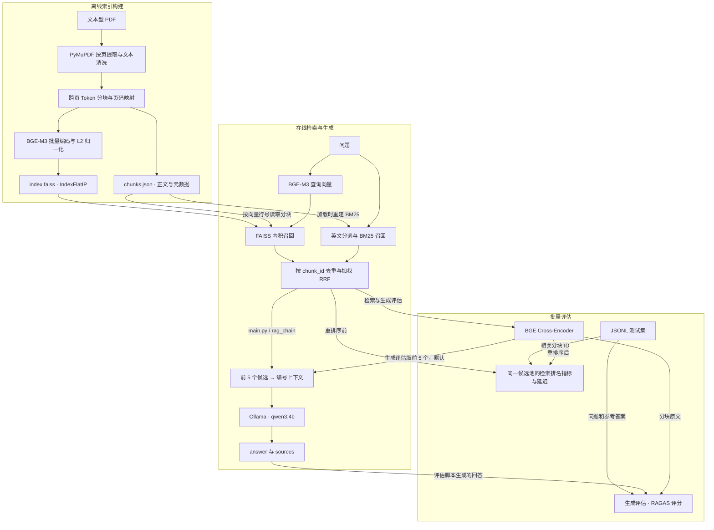

# Hybrid-RAG-System

## 1. Project Overview（项目概述）

Hybrid-RAG-System 是一个面向英文技术论文的本地检索增强问答系统。它将 PDF 正文按 Token 切分，使用 BM25 和 BGE-M3 + FAISS 召回候选片段，再通过 Reciprocal Rank Fusion（RRF）汇总排名。问答链将检索上下文交给本地 Ollama 模型，并返回可映射到源文件和分块 ID 的编号引用。

项目将文档处理、索引持久化、检索排序、生成与评估拆分为独立模块。问答示例使用 RRF 排名直接生成。检索评估比较同一批候选重排序前后的表现，生成评估使用 Cross-Encoder 重排序后的候选。

## 2. Highlights（项目亮点）

- **跨页 Token 分块与证据定位**。项目实现了论文文本清洗、滑动窗口和 Token 到原始页码的映射。`chunk_id` 贯穿索引、检索融合、测试集标注和生成引用。
- **双路召回与加权 RRF**。项目封装了稀疏与稠密检索接口，并实现按排名加权融合、按分块 ID 去重和召回来源记录。底层 BM25 打分、向量搜索和模型推理由第三方库提供。
- **可维护的本地索引**。FAISS 向量和文本元数据按行对应，加载时校验维度、数量与分块 ID。增量导入更新两路检索数据，独立修复脚本可按相同原始行位置移除重复向量及分块记录。
- **薄层编排与可诊断评估**。LangChain 通过 Runnable 复用现有检索和生成逻辑。项目实现检索指标、分阶段计时和逐题报告，并通过 RAGAS 接入生成质量评估。

## 3. System Architecture（系统架构）



## 4. Core Modules（核心模块）

### 文档导入与跨页分块

[text_loader/pdf_loader.py](text_loader/pdf_loader.py) 用 PyMuPDF 逐页提取排序后的文本，跳过清洗后为空的页面，输出 `{"text": ..., "metadata": {"source": ..., "page": ...}}`。页码从 1 开始，`source` 使用 PDF 文件名。[text_cleaner.py](text_loader/text_cleaner.py) 执行 NFC 规范化、常见连字和不可见字符处理，并按空行、标题和列表项组织段落。遇到跨行连字符时直接拼接两行，保留原连字符。

[chunker.py](chunker.py) 按源文件分组、按页码排序，用 Tokenizer 分别编码页面，再拼接 Token 序列并保存页码映射。每个 Chunk 包含正文、`<文件名>::chunk_<序号>`、`page_start`、`page_end`、`pages` 和 Token 区间。窗口配置为 `chunk_size=512`、`chunk_overlap=64`，步长为 448。当前切片右端采用 `start + chunk_size - 1` 且右端不包含，因此常规窗口实际为 511 Token，重叠为 63 Token。切块规则、PDF 文件名和提取内容都会影响测试标注与分块的对应关系。

当前导入链支持可提取文本的 PDF。Markdown 和 TXT 模块为占位文件，扫描件 OCR 尚未实现。

### BM25 稀疏检索

[BM25.py](BM25.py) 实现小写化、英文单词和数字分词、重复 ID 校验、候选过滤及 Top-K 排序，底层打分使用 `rank_bm25.BM25Okapi`。分词保留常见带连字符或撇号的英文词形及小数。查询时先对语料计算 BM25 分数，再过滤掉与查询无共享词项的 Chunk，按分数降序返回 `{score, chunk, retriever}`。同分时按原始语料顺序排序。加载 `chunks.json` 时重新分词并构建内存索引。

### BGE-M3 与 FAISS 稠密检索

[Dense_Retriever.py](Dense_Retriever.py) 通过 Hugging Face Transformers 加载 `BAAI/bge-m3`，复用同一模型编码文档与查询。封装采用批量推理、最后一层首 Token（CLS）池化与 L2 归一化。默认批大小为 4，编码长度上限为 1024 Token，超限时报错。当前检索使用 BGE-M3 的稠密表示。

分块向量以 `float32` 写入 `faiss.IndexFlatIP`。单位向量的内积等价于余弦相似度，因此 FAISS 对向量执行精确 Top-K 搜索，分块正文和元数据按索引返回的行号取回。存储层分别持久化 `index.faiss` 和 `chunks.json`，加载时校验分块结构、ID 唯一性、向量维度和行数。

### Hybrid Retrieval 与 RRF

[hybrid_retriever.py](hybrid_retriever.py) 对同一问题依次执行 BM25 与 FAISS 召回。默认每路取 20 个候选，问答返回融合后的前 5 个。RRF 按 `chunk_id` 合并两路候选，保留命中的检索器标记，并对候选在各路的排名累加倒数分数。

$$
\operatorname{RRF}(d) = \sum_{r \in \{\mathrm{BM25},\,\mathrm{FAISS}\}:\,d \in r}
\frac{w_r}{k_0 + \operatorname{rank}_r(d)}
$$

排名从 1 开始，候选缺席的召回路贡献为 0。默认平滑常数 `k_0=60`，两路权重均为 1.0。融合使用名次，因此 BM25 分数和向量相似度无需放在同一尺度比较。

### Cross-Encoder 重排序

[Reranker.py](Reranker.py) 将每个候选构造成 `[query, chunk_text]`，调用 Sentence Transformers 的 `CrossEncoder.predict()` 批量预测相关性，再按模型分数截取 Top-K。默认使用 `BAAI/bge-reranker-base`，最大输入长度为 512 Token，批大小为 16。现有实现将重排序分数写入返回字典的 `score`，原检索结果字典保持原样。Cross-Encoder 只处理已召回的候选，召回遗漏会保留到下游。

### LLM 生成与引用溯源

[llm_generator.py](llm_generator.py) 将排名前 5 的候选整理为编号上下文，每块正文最多取 2,000 个字符。系统 Prompt 要求使用给定证据、在上下文不足时说明、将检索文本视为数据、用 `[1]` 等编号引用并使用提问语言。模块使用 OpenAI Python SDK 调用本地 Ollama 的 OpenAI 兼容接口，默认模型为 `qwen3:4b`，温度为 0.1。没有可用上下文时直接返回提示。

输出为 `{answer, sources}`，`sources` 保存传给模型的证据编号、源文件名和分块 ID。页码保留在分块元数据中，可按 `chunk_id` 回查。生成后暂无编号校验或引用与答案声明的一致性校验。

### LangChain 编排

[Langchain.py](Langchain.py) 使用 LCEL 将 `RunnablePassthrough`、检索和生成步骤组合成 `rag_chain`。适配函数在项目检索结果与 LangChain `Document` 之间转换，保留分块元数据、检索来源及分数。`add_document_chain` 在已有索引上导入 PDF，校验新增分块 ID，追加向量并保存，再从更新后的 Chunk 文件重建 BM25。`evaluate_test_set_runnable` 复用检索评估器，输出混合检索指标和耗时。向量编码、检索和生成仍执行前述项目模块。

## 5. Technical Stack（技术栈）

| 类别 | 组件 | 用途 |
| --- | --- | --- |
| 文档处理 | PyMuPDF、Python `re` / `unicodedata` | PDF 抽取、清洗与结构恢复 |
| 稀疏检索 | `rank_bm25.BM25Okapi` | 英文词项匹配与 BM25 打分 |
| 稠密检索 | Hugging Face Transformers、PyTorch、`BAAI/bge-m3`、FAISS | 批量编码、向量持久化与精确内积检索 |
| 排名融合 | 项目实现的加权 RRF | 双路排名聚合、去重和来源记录 |
| 重排序 | Sentence Transformers、`BAAI/bge-reranker-base` | 对查询和候选片段联合打分 |
| 生成 | OpenAI Python SDK、Ollama、`qwen3:4b` | 调用本地模型生成带编号引用的答案 |
| 流程编排 | LangChain Core、LCEL | 包装检索、生成、增量导入和检索评估 |
| 评估 | 项目实现的排名指标、RAGAS Collections | 检索质量、分段延迟与生成质量评估 |

## 6. Project Structure（项目结构）

```text
Hybrid-RAG-System/
├── main.py                         # 原始命令行问答示例
├── BM25.py                         # 英文分词、稀疏检索与索引重建
├── Dense_Retriever.py              # BGE-M3 编码与 FAISS 存储
├── hybrid_retriever.py             # 双路召回与加权 RRF
├── Reranker.py                     # Cross-Encoder 重排序
├── llm_generator.py                # Prompt、模型调用与引用整理
├── Langchain.py                    # Runnable 问答、增量导入与评估
├── chunker.py                      # 跨页 Token 分块及页码映射
├── text_loader/
│   ├── pdf_loader.py               # PDF 逐页提取
│   ├── text_cleaner.py             # 正文清洗
│   ├── md_loader.py                # 占位
│   └── txt_loader.py               # 占位
├── scripts/
│   └── deduplicate_faiss.py        # 按原始行位置同步去重
├── evaluate_retrieval.py           # 排名指标、重排序对比与延迟
├── evaluate_generation.py          # RAGAS 生成评估
├── data/
│   ├── DATASET.md                  # 样本来源与标注字段
│   ├── train.jsonl                 # 45 条训练样本
│   ├── test.jsonl                  # 15 条测试样本
│   ├── raw/                       # 本地 PDF，Git 忽略
│   └── faiss/                     # 本地索引、分块元数据，Git 忽略
├── .gitignore                      # 模型、私有文档、索引与报告忽略规则
└── README.md
```

## 7. Evaluation（系统评估）

### 测试数据与配置

[data/DATASET.md](data/DATASET.md) 描述了人工整理的英文论文 QA 数据。训练集 45 条、测试集 15 条，分别从 GPT-1、GPT-2、GPT-3 各取 15 条和 5 条。样本含参考答案、相关 `chunk_id` 和难负例 ID。现有评估脚本以 `test.jsonl` 为默认输入，训练样本与难负例尚无对应的训练脚本。

本次基线使用本地 `IndexFlatIP`，共 188 条 1024 维向量，覆盖 GPT-1、GPT-2、GPT-3 与 LLaMA 四篇论文。向量条数与元数据一致，测试集的 19 个不同相关分块 ID 均能匹配。向量与分块样本经重新编码抽查，基线使用 CUDA 执行 BGE-M3 编码、CPU 执行 FAISS 搜索。

### 检索指标与实测结果

[evaluate_retrieval.py](evaluate_retrieval.py) 按 ID 去除重复候选，逐题计分后取宏平均，默认评估 `K=1,3,5,10`。Recall@K 计算已召回相关分块占全部标注分块的比例，MRR@K 取首个相关分块的倒数排名，NDCG@K 使用二值相关性的归一化折损累积增益。Precision@K 固定除以 K，Hit Rate@K 统计至少命中一个相关分块的查询比例。

下表为本次在同一索引与全部 15 条测试题上直接调用项目检索器和评分函数得到的结果。单路均返回前 20 个候选，RRF 每路取 20 个并保留融合后的前 20 个，使用默认平滑常数和等权设置。

| 检索方法 | Recall@1 | Recall@5 | MRR@5 | NDCG@5 | Precision@5 | Hit Rate@5 | Recall@10 |
| --- | ---: | ---: | ---: | ---: | ---: | ---: | ---: |
| BM25 | 0.4000 | 0.9667 | 0.7022 | 0.7507 | 0.2400 | 1.0000 | 0.9667 |
| BGE-M3 + FAISS | 0.2667 | 0.5333 | 0.3689 | 0.4141 | 0.1200 | 0.5333 | 0.6667 |
| BM25 + FAISS + 等权 RRF | 0.3667 | 0.7000 | 0.5278 | 0.5584 | 0.1600 | 0.7333 | 0.9667 |

等权 RRF 的 Recall@5 高于纯稠密检索，低于 BM25。到 K=10，RRF 与 BM25 的 Recall 相同。当前结果只反映这 15 条英文论文题与现有索引，融合权重和跨语料泛化仍需验证。

<details>
<summary>复算三组检索基线（PowerShell）</summary>

```powershell
@'
from pathlib import Path

from evaluate_retrieval import evaluate_retrieval, load_jsonl
from Langchain import BGEembedding, BM_Retriever, faiss, hybridretirever

samples = load_jsonl(Path("data/test.jsonl"))
evaluator = evaluate_retrieval((1, 3, 5, 10))
rankings = {"BM25": [], "Dense": [], "RRF": []}

for sample in samples:
    query = sample["question"]
    results = {
        "BM25": BM_Retriever.search(query, top_k=20),
        "Dense": faiss.search(BGEembedding.embed_texts(query), top_k=20),
        "RRF": hybridretirever.search(query, top_k=20, candidate_k=20),
    }
    for name, candidates in results.items():
        rankings[name].append(evaluator.extract_result_ids(candidates))

labels = [sample["relevant_chunk_ids"] for sample in samples]
for name, rows in rankings.items():
    print(name, evaluator.evaluate_rankings(rows, labels))
'@ | python -
```

</details>

正式检索脚本对同一批 RRF 候选分别计算重排序前后的指标，默认预热 1 个查询，计时排除模型加载和预热，并在 CUDA 下同步后读数。脚本分别输出混合检索、重排序与两段合计耗时的均值、P50、P95、最小值和最大值，以及逐题结果。

### 生成指标与实验状态

[evaluate_generation.py](evaluate_generation.py) 默认对 20 个融合候选重排序后取 5 块生成，再逐题计算并汇总三项 RAGAS 指标。`Faithfulness` 衡量回答是否有检索上下文支持，`Answer Correctness` 对照人工参考答案，`Answer Relevancy` 衡量回答与提问的相关程度。评估复用 BGE-M3 Embedding，生成器与裁判默认均为本地 `qwen3:4b`。Faithfulness 使用重排序分块的完整正文，生成 Prompt 中的每块正文限制为 2,000 字符，两个输入口径可能不同。耗时分为检索至回答生成、RAGAS 打分、两段合计，分别记录均值、最小值和最大值。

| 实验 | 当前状态 |
| --- | --- |
| RRF 与 RRF + Cross-Encoder | 脚本已实现同候选对照。当前工作区未找到历史结果报告，本次环境缺少 Sentence Transformers 及重排序模型缓存，未取得重排序指标或分阶段延迟。 |
| RAGAS 生成评估 | 脚本已实现逐题评分和聚合。当前工作区未找到历史结果报告，本次环境缺少 RAGAS 及重排序依赖，未取得三个质量指标或生成延迟。 |

默认报告写入 `data/retrieval_evaluation_results.json` 与 `data/generation_evaluation_results.json`。报告路径可通过 `--output` 修改。现有产物无法确认最初构建索引时的完整依赖版本、模型权重修订号和历史实验环境。

## 8. Quick Start（快速开始）

以下命令以 Windows PowerShell 和 Conda 为例，从仓库根目录运行。Python 3.11 是安装示例使用的版本，仓库目前没有依赖锁文件。

### 1. 安装环境

```powershell
conda create -n hybrid-rag python=3.11 -y
conda activate hybrid-rag
python -m pip install --upgrade pip
python -m pip install "torch>=2.6" transformers numpy faiss-cpu pymupdf rank-bm25 openai langchain-core langchain-ollama

# 运行重排序与生成评估时安装
python -m pip install sentence-transformers
python -m pip install "ragas>=0.4,<0.5" instructor
```

索引和检索可在 CPU 上运行。要使用 NVIDIA GPU，安装与本机驱动兼容的 PyTorch 构建，项目会通过 `torch.cuda.is_available()` 自动选择编码设备。[PyTorch 安装指南](https://pytorch.org/get-started/locally/)

### 2. 准备模型和 PDF

首次加载时 Transformers 会获取 `BAAI/bge-m3`。运行评估时 Sentence Transformers 还会获取 `BAAI/bge-reranker-base`。两个评估脚本的 `--embedding-model` 与 `--reranker-model` 支持填写对应模型的本地目录。查询编码应使用与索引构建一致的模型和池化方式。

问答与生成评估需要 Ollama。安装后启动应用。若本地服务尚未启动，在单独终端运行 `ollama serve`。生成器使用 `http://localhost:11434/v1`，本地服务无需真实 API 密钥。[Ollama Windows 安装](https://docs.ollama.com/windows) · [OpenAI 兼容接口](https://docs.ollama.com/api/openai-compatibility)

```powershell
ollama pull qwen3:4b
ollama list
New-Item -ItemType Directory -Force data/raw | Out-Null
```

下载以下公开论文 PDF，并按文件名放入 `data/raw/`。原文未随仓库分发。复跑现有标注时，PDF 版本或文本提取结果变化后应重新核对相关分块 ID 和对应内容。

| 文件名 | 论文 |
| --- | --- |
| `GPT-1.pdf` | [Improving Language Understanding by Generative Pre-Training](https://cdn.openai.com/research-covers/language-unsupervised/language_understanding_paper.pdf) |
| `GPT-2.pdf` | [Language Models are Unsupervised Multitask Learners](https://cdn.openai.com/better-language-models/language_models_are_unsupervised_multitask_learners.pdf) |
| `GPT-3.pdf` | [Language Models are Few-Shot Learners（NeurIPS 版）](https://proceedings.neurips.cc/paper/2020/file/1457c0d6bfcb4967418bfb8ac142f64a-Paper.pdf) |
| `LLaMA.pdf` | [LLaMA: Open and Efficient Foundation Language Models](https://arxiv.org/pdf/2302.13971) |

### 3. 构建本地索引

初次克隆后，组合仓库中的现有模块来构建第一份索引。以下脚本检测到已有索引或分块文件时会停止，避免覆盖。使用自有语料时，修改文件列表即可。要评估自有语料，请提供与该索引匹配的测试集。

```powershell
@'
from pathlib import Path

from transformers import AutoModel, AutoTokenizer

from chunker import Chunker
from Dense_Retriever import BGEEmbedding, FAISSStore
from text_loader.pdf_loader import load_pdf

index_dir = Path("data/faiss")
if any((index_dir / name).exists() for name in ("index.faiss", "chunks.json")):
    raise SystemExit("Index files already exist in data/faiss.")

raw_dir = Path("data/raw")
files = ("GPT-1.pdf", "GPT-2.pdf", "GPT-3.pdf", "LLaMA.pdf")
docs = [doc for name in files for doc in load_pdf(raw_dir / name)]

model_id = "BAAI/bge-m3"
tokenizer = AutoTokenizer.from_pretrained(model_id)
chunks = Chunker(tokenizer).chunk_documents(docs)
if not chunks:
    raise SystemExit("No text chunks were extracted from the PDFs.")

embedder = BGEEmbedding(tokenizer, AutoModel.from_pretrained(model_id))
store = FAISSStore(dim=embedder.embedding_dim)
store.validate_chunks(chunks)
store.add(embedder.embed_chunks(chunks), chunks)
store.save(index_dir)
print(f"Indexed {len(chunks)} chunks in {index_dir}")
'@ | python -
```

### 4. 运行问答和评估

用 `rag_chain` 运行任意单条问题，检索和生成会接收同一个问题。原有 `main.py` 可作为模块调用示例，其中检索与生成写了两个不同的固定问题。`python Langchain.py` 运行的是测试集上的混合检索评估。`Dense_Retriever.py` 和 `Reranker.py` 的模块内演示仍引用旧接口，索引构建和评估可使用本节命令。

```powershell
python -c "from Langchain import rag_chain; print(rag_chain.invoke('How many Transformer layers does GPT-1 use?'))"

python evaluate_retrieval.py --candidate-k 20 --k-values 1,3,5,10
python evaluate_generation.py --candidate-k 20 --context-k 5 --limit 1
```

移除 `--limit 1` 可运行全量生成评估。两套评估均支持用 `--device cpu` 指定 Embedding 和重排序模型的设备，用 `--test-file` 和 `--faiss-dir` 切换数据。生成评估还支持 `--generator-model`、`--judge-model` 和 `--judge-base-url`。Ollama 的推理设备由服务管理。更换本地模型前先通过 `ollama pull` 下载对应标签。RAGAS 评估使用 Collections API，裁判端须支持脚本所需的结构化输出。[RAGAS Collections 文档](https://docs.ragas.io/en/stable/howtos/migrations/migrate_from_v03_to_v04/)

## 9. Usage Example（使用示例）

以 `How many Transformer layers does GPT-1 use?` 调用 `rag_chain`，本次本地运行返回了以下结果。`answer` 为原文节选，`sources` 保留全部五条上下文记录。

```json
{
  "answer": "The context mentions that GPT-1 uses a \"multi-layer Transformer decoder\" (document [5]), and the mathematical notation shows that there are \"n\" layers where \"n is the number of layers\" (document [5]). However, the retrieved context does not explicitly state what value \"n\" takes for GPT-1.",
  "sources": [
    {"reference": "[1]", "chunk_id": "GPT-3.pdf::chunk_5", "source": "GPT-3.pdf"},
    {"reference": "[2]", "chunk_id": "GPT-1.pdf::chunk_13", "source": "GPT-1.pdf"},
    {"reference": "[3]", "chunk_id": "GPT-3.pdf::chunk_4", "source": "GPT-3.pdf"},
    {"reference": "[4]", "chunk_id": "LLaMA.pdf::chunk_25", "source": "LLaMA.pdf"},
    {"reference": "[5]", "chunk_id": "GPT-1.pdf::chunk_5", "source": "GPT-1.pdf"}
  ]
}
```

这次问答将上下文不足作为结论。引用编号对应 `sources[].reference`。需要查看页码和原始片段时，在 `data/faiss/chunks.json` 中按 `chunk_id` 查找 `metadata.pages` 和 `text`。

## 10. Future Work（未来规划）

以下方向尚未实现。

- **可复现实验**。固化依赖和模型修订号，记录 PDF 版本与索引构建参数。扩充测试集，在开发集上选择 RRF 权重，并发布 BM25、Dense、RRF、RRF + Cross-Encoder 的消融结果、延迟与失败案例。
- **生成与证据验证**。给返回的引用附上页码，检查编号是否存在、声明是否被所引分块支持。统一 Faithfulness 与实际 Prompt 的上下文口径，并用独立裁判或人工样本校验评分。
- **Query Rewrite、Multi-hop Retrieval 与 Agentic RAG**。依次评估查询改写对召回的影响、问题分解与跨文档证据合并，再引入带明确步数和调用预算的工具式检索。
- **工程交付**。提供独立索引 CLI、可配置的问答入口和端到端测试，使用小型公开语料验证新环境中的完整流程，并补充适用于开源发布的许可证。
